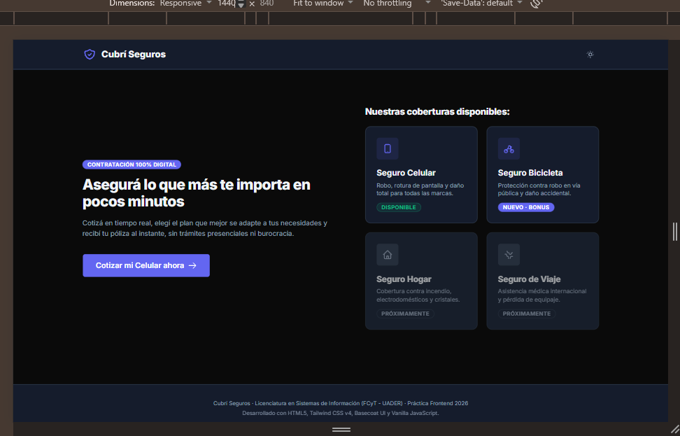

ENLACE DEL SITIO: https://pablososa388.github.io/UX-UI_TPS/

Trabajo Práctico Frontend · Licenciatura en Sistemas de Información (FCyT - UADER)  
**Diseño UXUI - 2026**

Sitio web interactivo para la cotización y contratación digital de seguros, maquetado con máxima fidelidad a partir del diseño de Figma, desarrollado con **HTML5, Tailwind CSS v4, Basecoat UI y JavaScript vanilla** (sin frameworks).

---

## 📸 Capturas de Pantalla

### 🖥️ Vistas Desktop (1440px)
*Ubicación: `screenshots/screens1440px/`*

| 01. Inicio / Catálogo | 02. Elegir Plan |
| :---: | :---: |
|  |  |

| 03. Datos Personales | 04. Confirmación y Pago |
| :---: | :---: |
|  |  |

| 05. Contratación Exitosa | 06. Tarjeta Rechazada (Simulación) |
| :---: | :---: |
|  |  |

---

### 📱 Vistas Mobile (390px)
*Ubicación: `screenshots/screens390px/`*

| 01. Inicio | 02. Cotización | 03. Resumen de Plan |
| :---: | :---: | :---: |
|  |  |  |

| 04. Completar Datos | 05. Confirmación y Pago | 06. Pago Exitoso | 07. Tarjeta Rechazada |
| :---: | :---: | :---: | :---: |
|  |  |  |  |

---

## 🚀 Cómo correr el proyecto

El proyecto cuenta con doble soporte de ejecución: **modo directo (sin build / CDN)** y **modo avanzado con Vite + npm**.

### Opción 1: Ejecución directa (Sin build / CDN)
No requiere Node ni compilación previa.
1. Abrir la carpeta del proyecto en VS Code o cualquier editor.
2. Iniciar con **Live Server** (extensión de VS Code) sobre `index.html`, o bien ejecutar en terminal:
   ```bash
   npx serve .
   ```
3. Abrir en el navegador la dirección local indicada (ej. `http://localhost:3000` o `http://localhost:5500`).

### Opción 2: Vite + npm (Modo recomendado para producción)
1. Instalar dependencias:
   ```bash
   npm install
   ```
2. Iniciar servidor de desarrollo en caliente:
   ```bash
   npm run dev
   ```
3. Compilar para producción:
   ```bash
   npm run build
   ```
4. Previsualizar compilado:
   ```bash
   npm run preview
   ```

---

## 🏛️ Arquitectura del Proyecto (Sin Código Spaghetti)

Se ha aplicado una estricta separación de responsabilidades tanto en hojas de estilo como en la lógica de negocio, evitando archivos monolíticos o desordenados:

```text
cubri-seguros/
├── index.html                   ← Vista única con secciones data-paso="X"
├── package.json                 ← Dependencias y scripts de desarrollo Vite
├── vite.config.js               ← Configuración de empaquetado para deploy relativo
├── .github/
│   └── workflows/
│       └── deploy.yml           ← Workflow CI/CD automático para GitHub Pages
├── screenshots/
│   ├── screens1440px/           ← Capturas en resolución Desktop (1440px)
│   └── screens390px/            ← Capturas en resolución Mobile (390px)
├── css/
│   ├── main.css                 ← Orquestador de imports CSS
│   ├── tokens.css               ← Variables CSS (colores de Figma, radios, tipografía)
│   ├── base.css                 ← Resets, escalas tipográficas y focus accesible
│   ├── layout.css               ← Rejilla de 2 columnas, responsive desktop y mobile
│   ├── dark-mode.css            ← Overrides de tema oscuro mediante variables
│   └── components/
│       ├── stepper.css          ← Stepper de 4 pasos (completado, activo, pendiente)
│       ├── forms.css            ← Fields, inputs, selects nativos, chips de antigüedad
│       ├── cards.css            ← Cards de catálogo y cards de plan interactivo
│       ├── summary.css          ← Resumen de cotización (aside desktop y barra mobile)
│       ├── alert.css            ← Variantes informativas y destructivas de Basecoat
│       ├── toast.css            ← Notificaciones flotantes animadas
│       └── modal.css            ← Modal accesible para términos y condiciones
├── data/
│   ├── planes.json              ← Datos oficiales de planes de Celular
│   └── planes-bicicleta.json    ← Datos oficiales de planes de Bicicleta (Bonus)
└── js/
    ├── app.js                   ← Punto de entrada, listeners de eventos y navegación
    ├── estado.js                ← Estado único reactivo (solicitud) y persistencia
    ├── cotizador.js             ← Lógica pura de cálculo de cuotas y moneda es-AR
    ├── validaciones.js          ← Funciones puras de validación de campos y pasos
    ├── pago.js                  ← Simulación asíncrona de pago y póliza POL-AAAA-NNNNNN
    ├── render.js                ← Renderizador reactivo del DOM (Regla de Oro)
    ├── masks.js                 ← Máscaras de entrada (tarjeta 4x4, vencimiento MM/AA)
    ├── toast.js                 ← Notificaciones toast estilo Basecoat UI
    └── theme.js                 ← Alternador de modo oscuro con persistencia
```

---

## 🌟 Cumplimiento del Punto 12 (Bonus / Opcionales)

Se han implementado **todos** los requisitos opcionales contemplados en el punto 12 de las consignas:

1. **Persistencia en `localStorage`**:
   - El estado de la `solicitud` se sincroniza automáticamente en cada cambio.
   - Si el usuario refresca la página (F5), se restauran todos los datos cargados y el paso exacto en el que se encontraba.
   - Al completar la contratación o hacer clic en "Volver al inicio", el storage se limpia ordenadamente.

2. **Editar desde el resumen**:
   - En el panel de resumen lateral figuran enlaces "Editar" para Equipo, Plan y Titular.
   - Al hacer clic, el usuario es redirigido al paso correspondiente y, gracias a la bandera de edición rápida, un banner superior le permite regresar directamente al pago sin perder datos ni tener que atravesar nuevamente los pasos intermedios.

3. **Toast de confirmación**:
   - Sistema de notificaciones flotantes estilo Basecoat UI que confirma visualmente la aprobación del pago, la restauración de sesión o avisos de validación con animación suave y cierre automático.

4. **Habilitación de otro producto (Seguro de Bicicleta)**:
   - En el catálogo inicial (Paso 0) está habilitada la contratación de "Seguro Bicicleta" junto con "Seguro Celular".
   - Al seleccionar Bicicleta, se cargan dinámicamente marcas de bicicletas reconocidas (Trek, Specialized, Giant, Venzo, Raleigh) y el archivo `data/planes-bicicleta.json` con coberturas especializadas para ciclistas.

5. **Máscaras de Input**:
   - **Número de tarjeta**: Formateo automático en 4 bloques de 4 dígitos separados por espacio (`XXXX XXXX XXXX XXXX`).
   - **Vencimiento**: Formateo automático de fecha `MM/AA` con inserción automática de la barra `/`.
   - **DNI y Celular**: Sanitización de caracteres no numéricos y formateo telefónico.
   - **Valor asegurado**: Formateo monetario con separadores de miles en tiempo real.

6. **Modo Oscuro (Dark Mode)**:
   - Toggle interactivo con ícono de sol/luna en la barra de navegación superior.
   - Implementado mediante variables CSS nativas y clase `.dark` sobre el elemento raíz, adaptando automáticamente fondos, bordes, tipografías y componentes Basecoat.
   - Detecta la preferencia del sistema operativo (`prefers-color-scheme`) y persiste la elección en `localStorage`.

7. **Setup con Vite y Deploy Automático en GitHub Actions**:
   - Configuración completa con `vite.config.js` y `package.json`.
   - Pipeline de integración continua en `.github/workflows/deploy.yml` listo para desplegar automáticamente a **GitHub Pages** en cada push a la rama `main`.

---

## 🧪 Casos de Prueba Oficiales (Sección 5.1)

Todos los casos de prueba de la fórmula de cuota:
$$\text{cuota} = \text{Math.round}(\text{valor} \times \text{tasaAnual} / 12 \times \text{factorAntiguedad})$$

| Caso de Prueba | Valor | Antigüedad | Factor | Plan Básico (4%) | Plan Plus (6%) | Plan Premium (9%) |
| :--- | :--- | :--- | :---: | :---: | :---: | :---: |
| **Caso 1** | \$ 600.000 | Menos de 1 año | 1,00 | **\$ 2.000** | **\$ 3.000** | **\$ 4.500** |
| **Caso 2** | \$ 600.000 | 1 a 2 años | 1,10 | **\$ 2.200** | **\$ 3.300** | **\$ 4.950** |
| **Caso 3** | \$ 1.200.000 | Más de 2 años | 1,25 | **\$ 5.000** | **\$ 7.500** | **\$ 11.250** |

*Verificado mediante suite automatizada de pruebas unitarias (`55 pasadas, 0 falladas`).*

---

## 💳 Simulación de Pagos (Sección 5.3)

- **Tarjeta Aprobada**: `4111 1111 1111 1111` (o cualquier otro número de 16 dígitos válido).
  - Resultado: Deshabilita el botón durante 1,5 segundos mostrando "Procesando pago...", emite la póliza en formato `POL-AAAA-NNNNNN` y navega a la pantalla de éxito.
- **Tarjeta Rechazada**: `4000 0000 0000 0002`.
  - Resultado: Navega a la pantalla de error de pago. El botón "Reintentar" o "Cambiar medio de pago" regresa al formulario conservando todos los datos intactos.

---

## 📸 Capturas de Pantalla (Las 7 Pantallas)

Guardá tus capturas dentro de la carpeta `docs/screenshots/` con estos nombres para que GitHub las muestre automáticamente:

### 1. Pantalla 01: Inicio / Catálogo


### 2. Pantalla 02: Cotizar (Paso 1)


### 3. Pantalla 03: Elegir Plan (Paso 2)


### 4. Pantalla 04: Datos Personales (Paso 3)


### 5. Pantalla 05: Confirmación y Pago (Paso 4)


### 6. Pantalla 06: Éxito (Póliza Emitida)


### 7. Pantalla 07: Error de Pago (Rechazo Simulado)
*(Se obtiene al pagar con la tarjeta de prueba: `4000 0000 0000 0002`)*  


---

## 📱 Criterios de Aceptación y Checklist

- [x] **7 pantallas completas** funcionales y validadas en mobile (390 px) y desktop (1440 px).
- [x] **Los 3 casos de prueba** dan exactamente los valores requeridos.
- [x] **Validaciones estrictas en línea** al perder el foco (`blur`) con accesibilidad ARIA (`data-invalid`, `aria-invalid`, `role="alert"`).
- [x] **Conservación de datos**: El botón "Volver" no pierde ningún dato previamente ingresado.
- [x] **Tarjeta rechazada** (`4000 0000 0000 0002`) deriva a pantalla 07 y permite reintentar sin borrar datos.
- [x] **Formato de póliza**: Generación estricta con formato `POL-AAAA-NNNNNN`.
- [x] **Consola limpia**: Sin errores ni advertencias de JavaScript.
- [x] **Accesibilidad**: Etiquetas `<label for="...">`, navegación por teclado y contraste adecuado en modo claro y oscuro.

